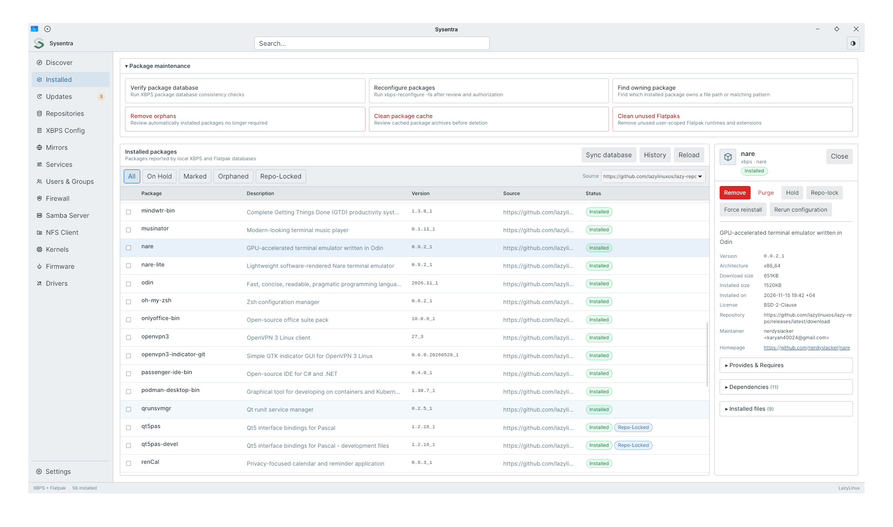
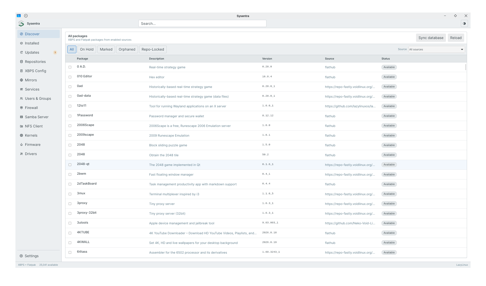
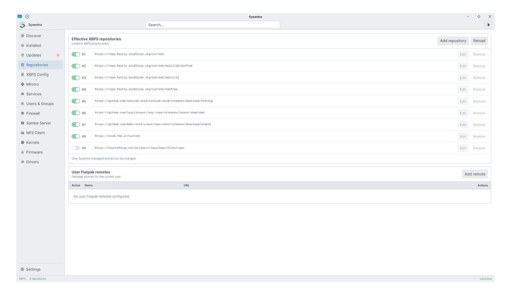
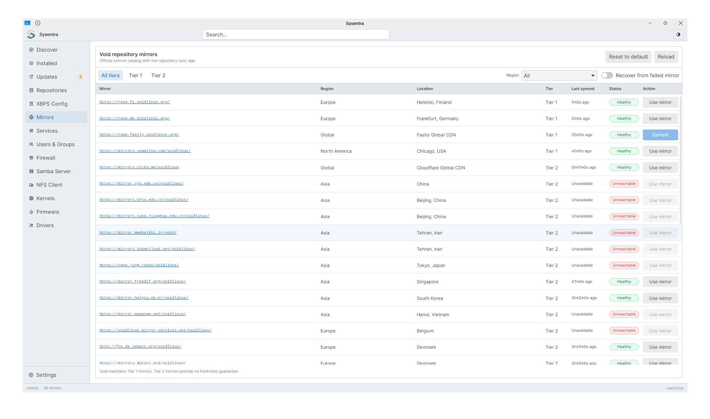
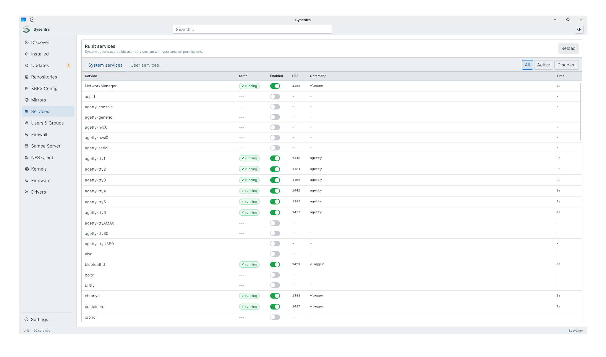
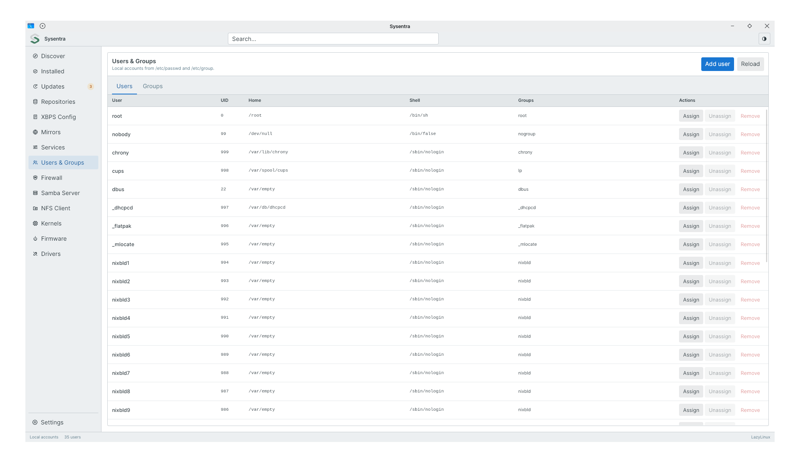
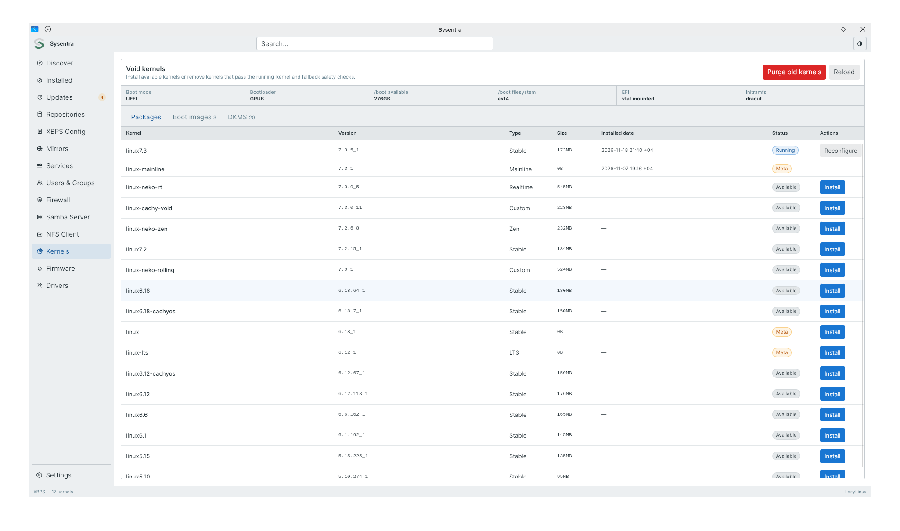
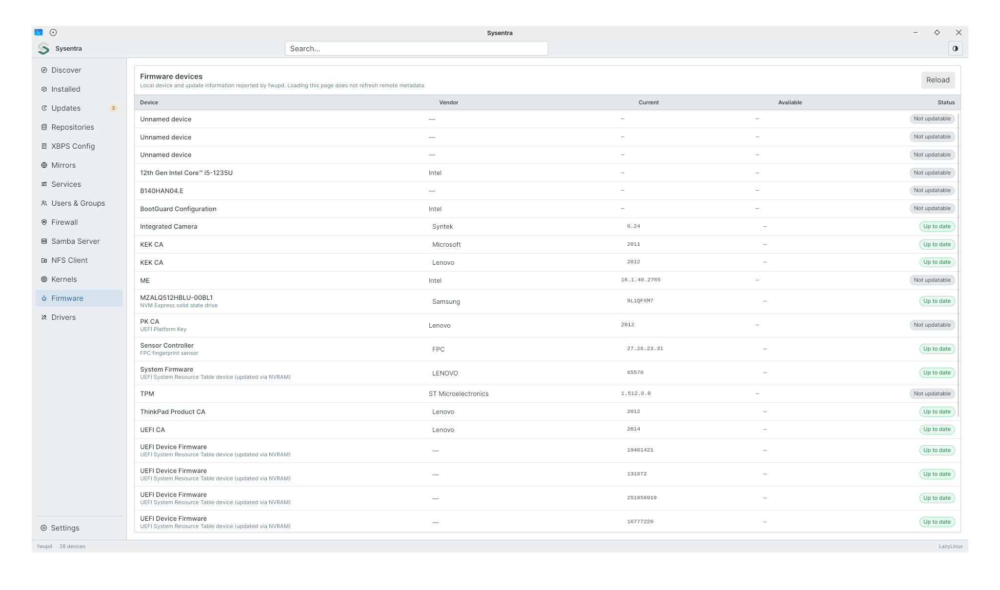
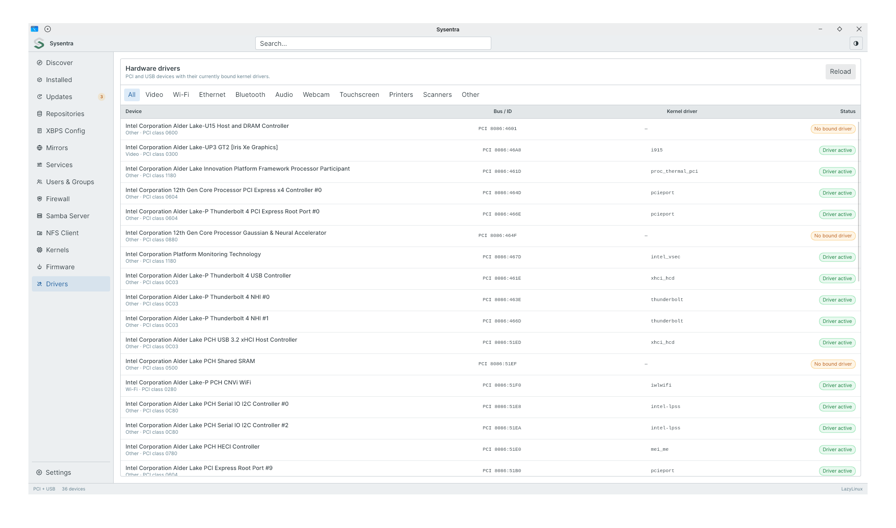
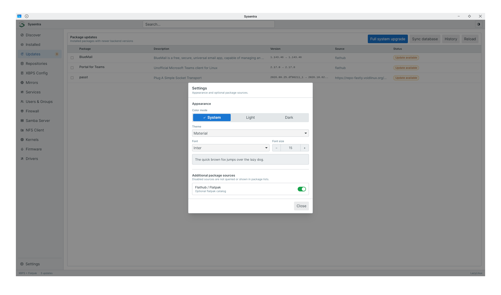

<div align="center">
<a href="https://github.com/nerdyslacker/Sysentra"></a>
</div>
<h1 align="center">Sysentra</h1>
<div align="center">

[](https://github.com/nerdyslacker/Sysentra/blob/main/LICENSE)
[](https://github.com/nerdyslacker/Sysentra/releases)
<a href="https://app.commanddash.io/agent?github=https://github.com/nerdyslacker/Sysentra"></a>
[](https://github.com/nerdyslacker/Sysentra/stargazers)
[](https://github.com/nerdyslacker/Sysentra/fork)

</div>

Sysentra is a software and system management center for Void Linux and derivatives.

## Current features

- Search, install, remove, update, hold, and repository-lock XBPS packages.
- Browse and manage Flatpak applications from Flathub.
- Install, safely remove, purge, and reconfigure Linux kernels; inspect boot images, boot/EFI capacity, bootloader, and DKMS state.
- Manage system and user runit services.
- Manage XBPS repositories, mirrors, and package rules.
- Inspect firmware and hardware drivers.
- Inspect firewall rules and manage Samba shares, NFS mounts, users, and groups.
- Preview privileged changes before polkit authorization.
- Choose light, dark, or system appearance with selectable themes and fonts.

## Screenshots


<div align="center">
    
</div>

<details>
<summary><b>More</b></summary>
<br />

| Discover | Repositories | Mirrors |
|---|---|---|
|   |  |  |

| Services | Users & Groups | Kernels |
|---|---|---|
|  |  |  |

| Firmware | Drivers | Settings |
|---|---|---|
|  |  |  |

</details>


## Installation

First add LazyLinux repository:

```sh
printf '%s\n' 'repository=https://github.com/lazylinuxos/lazy-repo/releases/latest/download' \
  | sudo tee /etc/xbps.d/99-repository-lazy.conf
```

Now execute install command:

```sh
sudo xbps-install -S sysentra
```

## Build dependencies

- `base-devel`
- `go` 1.26 or newer
- `nodejs`
- `gtk4-devel`
- `libwebkitgtk60-devel`
- Wails v3 CLI

## Runtime dependencies

- `gtk4`
- `libwebkitgtk60`
- `xbps`
- `runit`
- `dbus`
- `polkit`

Optional features use `flatpak`, `fwupd`, `turnstile`, `ufw` or `firewalld`, `samba`, and `nfs-utils`.

## Build

```sh
cd frontend
npm ci
npm run check
cd ..
wails3 generate bindings -ts .
cd frontend
npm run build
cd ..
go build -buildvcs=false -o sysentra .
go build -buildvcs=false -o bin/sysentrad ./cmd/sysentrad
```

Install `bin/sysentrad`, the D-Bus service file, D-Bus policy, and polkit policy from `packaging/` to enable privileged actions.

A starter Void Linux package template is available at `packaging/void/template`. Set its release version and checksum after publishing a tagged source archive.
